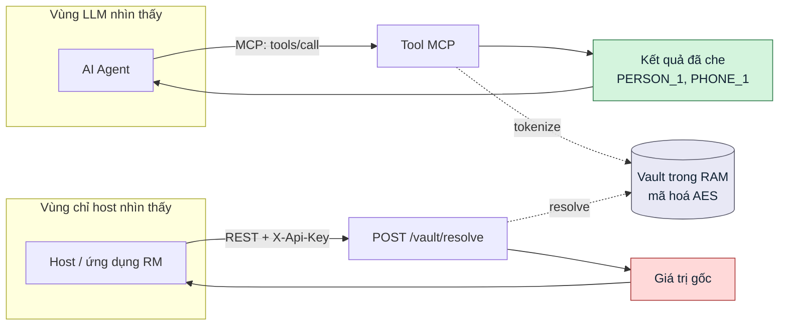
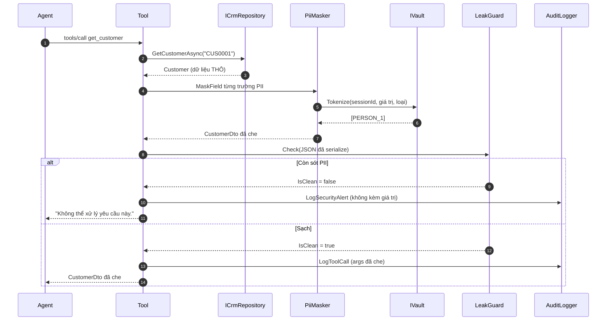

# BankAssist CRM MCP Server

MCP server viết bằng .NET, cung cấp tool tra cứu CRM ngân hàng cho AI agent, có lớp che dữ liệu cá nhân (PII masking) đặt ngay trong server.

**Giai đoạn MVP:** dữ liệu đọc từ file JSON, chưa có database.

---

## Vì sao masking nằm trong MCP server

Kết quả trả về từ tool CRM chính là dữ liệu khách hàng thật, và nó được chèn thẳng vào ngữ cảnh hội thoại của LLM. Nếu để host tự che, mỗi host mới lại phải cài lại lớp bảo vệ — và chỉ cần một host quên là dữ liệu rời hệ thống.

Đặt masking trong server nghĩa là: **không có đường nào lấy được dữ liệu thật qua giao thức MCP.** Mọi tool đều trả bản đã che.

Việc hoàn nguyên đi qua một cửa riêng: `POST /vault/resolve` — endpoint REST thường, không đăng ký làm MCP tool, nên LLM không nhìn thấy và không gọi được. Chỉ host gọi được bằng API key.



Đường màu đỏ không nối với `agent` — đó là toàn bộ thiết kế gói trong một hình.

### Luồng bên trong một lời gọi tool

Mọi tool đều đi đủ năm mắt xích, không tool nào được bỏ qua mắt nào:



`LeakGuard` chạy trên **chuỗi JSON đã serialize**, tức là sau cùng — nó bắt được cả trường hợp lập trình viên quên gọi masker.

---

## Yêu cầu môi trường

- macOS (Apple Silicon), .NET 10 SDK arm64
- Không cần database, không cần Docker cho MVP

```bash
dotnet --version     # kỳ vọng 10.x
```

## Chạy

```bash
git clone <repo> && cd bankassist-mcp
dotnet restore
dotnet run --project src/BankAssist.Mcp
```

Server lắng nghe `http://localhost:5026`.

Lần chạy đầu cần hai khoá, thiếu là server **từ chối khởi động** — cố ý, để không ai chạy nhầm với khoá mặc định. Đặt vào `src/BankAssist.Mcp/appsettings.Development.json` (file này đã nằm trong `.gitignore`):

```json
{
  "BANKASSIST_AES_KEY": "<32 byte ngẫu nhiên, mã Base64>",
  "BANKASSIST_API_KEY": "<chuỗi tối thiểu 16 ký tự>"
}
```

| Đường dẫn | Mục đích | Trạng thái |
|---|---|---|
| `/mcp` | Endpoint MCP (Streamable HTTP) | ✅ |
| `/health` | Kiểm tra sống | ✅ |
| `/vault/resolve` | Hoàn nguyên token — cần header `X-Api-Key` | ✅ |

## Kiểm tra bằng MCP Inspector

```bash
npx @modelcontextprotocol/inspector
# Transport: Streamable HTTP
# URL: http://localhost:5026/mcp
```

Bấm **List Tools**. Đích cuối là 6 tool; hiện có `get_customer`, `search_customers` và `ping` tạm (T-15 sẽ gỡ `ping`).

---

## Cách test masking

Ba tầng, đi từ nhanh nhất tới sát thực tế nhất. Tầng 1 chạy trong vài chục mili giây nên dùng khi đang code; tầng 3 dùng khi muốn tin vào kết quả.

### Tầng 1 — Test tự động

```bash
dotnet test                              # toàn bộ
dotnet test --filter Category=Pii        # chỉ ca liên quan che dữ liệu
dotnet test --filter Category=Repository # chỉ tầng truy cập dữ liệu
dotnet test --filter Category=Session    # chỉ ca phiên
```

| Ca | Kiểm điều gì | Ở đâu |
|---|---|---|
| T-04 | `get_customer` không để lọt tên, số điện thoại, CCCD, số tài khoản, email thật | `CustomerToolsTests.cs` |
| T-05 | Mã không tồn tại → rỗng kèm thông báo, không ném exception | `CustomerToolsTests.cs` |
| US-02 | Cùng khách trong cùng phiên nhận **cùng** token qua hai tool khác nhau | `CustomerToolsTests.cs` |
| A-01 | Mỗi lời gọi sinh đúng một dòng audit, trong đó không có PII thô | `CustomerToolsTests.cs` |
| V-01…V-07 | Vault hoàn nguyên đúng, cô lập theo phiên, lưu ở dạng mã hoá | `VaultTests.cs` |
| T-08 | Thiếu header `X-Session-Id` vẫn chạy nhưng ghi cảnh báo | `SessionContextTests.cs` |

### Tầng 2 — Gọi tay qua HTTP

Chỉ cần **một** request, không phải bắt tay trước:

```bash
curl -s -X POST http://localhost:5026/mcp \
  -H 'Content-Type: application/json' \
  -H 'Accept: application/json, text/event-stream' \
  -H 'X-Session-Id: rm-test-001' \
  -H 'X-Rm-Id: RM007' \
  -d '{"jsonrpc":"2.0","id":1,"method":"tools/call",
       "params":{"name":"get_customer","arguments":{"customerId":"CUS0001"}}}'
```

Kết quả kỳ vọng — mọi trường PII là token, `customerId` giữ nguyên vì nó là mã nội bộ:

```json
{"items":[{"customerId":"CUS0001","fullName":"[PERSON_1]","phone":"[PHONE_1]",
"cccd":"","accountNo":"[ACCOUNT_1]","email":"[EMAIL_1]",
"segment":"Standard","assignedRmId":"RM002","openedDate":"2022-06-06"}],"count":1}
```

Trong Postman: **POST** `http://localhost:5026/mcp`, ba header trên, body y hệt. Response là `text/event-stream` nên nội dung nằm ở dòng bắt đầu bằng `data:`.

Vài ca đáng thử tay:

| Gửi gì | Kỳ vọng |
|---|---|
| `arguments: {"customerId":"CUS0001"}` | Token ở mọi trường PII |
| Gọi lại đúng request đó, **cùng** `X-Session-Id` | Nhận lại **cùng** token |
| Gọi lại nhưng **đổi** `X-Session-Id` | Token đánh số lại từ đầu, phiên cũ không dùng được |
| `arguments: {"customerId":"CUS9999"}` | `count: 0` kèm thông báo, không stack trace |
| `arguments: {"customerId":""}` | Thông báo hướng dẫn giá trị hợp lệ |
| Bỏ header `X-Session-Id` | Vẫn chạy, log server có cảnh báo tự sinh phiên |

### Tầng 3 — Đọc nhật ký audit

```bash
tail -f src/BankAssist.Mcp/logs/audit-$(date +%Y%m%d).jsonl
```

```json
{"ts":"2026-08-08T21:21:34+07:00","sessionId":"rm-test-001","rmId":"RM007",
 "tool":"get_customer","args":{"customerId":"CUS0001"},"resultCount":1,
 "maskedCounts":{"PERSON":1,"PHONE":1,"ACCOUNT":1,"EMAIL":1},"durationMs":3,"level":"Info"}
```

Cách kiểm tra thẳng thắn nhất: lấy một tên có thật trong `data/customers.json` rồi tìm nó trong nhật ký. Không được có kết quả nào.

```bash
grep -c "Nguyễn" src/BankAssist.Mcp/logs/*.jsonl   # kỳ vọng: 0
```

Dòng `level: "SecurityAlert"` nghĩa là LeakGuard đã chặn một kết quả — có PII lọt qua masker. Đó là lỗi phải sửa ngay, không phải cảnh báo bỏ qua được.

---

## Cách lấy full name chưa che

**Qua MCP thì không có cách nào, và đó là chủ đích.** Không tool nào trả dữ liệu chưa che; thêm một tool như vậy là phá bỏ toàn bộ lý do dự án này tồn tại.

Đường hợp lệ duy nhất là cửa hoàn nguyên, dành cho host chứ không cho agent:

```bash
curl -s -X POST http://localhost:5026/vault/resolve \
  -H 'Content-Type: application/json' \
  -H "X-Api-Key: $BANKASSIST_API_KEY" \
  -d '{"sessionId":"rm-test-001","tokens":["[PERSON_1]","[PHONE_1]"]}'
```

```json
{ "resolved": { "[PERSON_1]": "...", "[PHONE_1]": "..." } }
```

Ba điều kiện phải đúng cùng lúc, thiếu một là không nhận được gì:

1. `X-Api-Key` khớp `BANKASSIST_API_KEY`, nếu không là `401`.
2. `sessionId` **trùng** giá trị `X-Session-Id` đã dùng lúc gọi tool. Sai phiên thì trả rỗng, không báo lỗi — cô lập theo phiên (ca V-03).
3. Phiên chưa quá TTL 30 phút và chưa bị `Drop`.

> ⏳ Endpoint này là **T-16, chưa cài đặt**. Hôm nay muốn kiểm chứng việc hoàn nguyên thì chạy `dotnet test --filter Category=Pii` — ca V-01 trong `VaultTests.cs` che một tên rồi hoàn nguyên và so lại với chuỗi gốc.

Endpoint này cố ý **không** xuất hiện trong `tools/list`. Ca E-04 trong TEST-SPEC tồn tại chỉ để bắt lỗi nếu ai đó gắn nhầm `[McpServerTool]` lên nó.

---

## Cấu trúc thư mục

```
src/BankAssist.Mcp/
  Program.cs
  Configuration/    # Options + SecretLoader (chết sớm nếu thiếu khoá)
  Tools/            # các class [McpServerToolType] + ToolPipeline
  Masking/          # PiiMasker, MemoryVault, LeakGuard, AuditLogger
    FreeText/       # recognizer VN: di động, CCCD, CMND
  Data/             # ICrmRepository + JsonCrmRepository
  Models/           # record thô (CrmRecords) và DTO đã che
data/               # JSON nguồn cho MVP, copy sang output lúc build
tests/BankAssist.Mcp.Tests/
docs/               # BRD, PRD, SPEC, TEST-SPEC, BACKLOG
```

`Models/CrmRecords.cs` là dữ liệu **thô**, `Models/Dtos.cs` là dữ liệu **đã che**. Chỉ kiểu trong `Dtos.cs` được phép rời tiến trình qua MCP — tách hai file để chỗ nào nhầm là thấy ngay khi đọc `using`.

## Tài liệu

| File | Nội dung |
|---|---|
| [docs/BRD.md](docs/BRD.md) | Bối cảnh nghiệp vụ, vấn đề, phạm vi |
| [docs/PRD.md](docs/PRD.md) | Yêu cầu sản phẩm, user story, tiêu chí chấp nhận |
| [docs/SPEC.md](docs/SPEC.md) | Đặc tả kỹ thuật — đọc file này trước khi code |
| [docs/TEST-SPEC.md](docs/TEST-SPEC.md) | Ca kiểm thử, đặc biệt các ca PII tiếng Việt |
| [docs/BACKLOG.md](docs/BACKLOG.md) | Danh sách công việc theo thứ tự thực hiện |
| [CLAUDE.md](CLAUDE.md) | Quy ước cho Claude Code |

---

## Ba điều tuyệt đối không làm

1. **Không đưa dữ liệu khách hàng thật vào `data/`.** Toàn bộ file JSON là dữ liệu giả sinh bằng script.
2. **Không log giá trị chưa che.** Kể cả khi debug. Log bản đã che, kèm hash của bản gốc nếu cần đối chiếu.
3. **Không biến `/vault/resolve` thành MCP tool.** Nếu LLM gọi được endpoint này thì toàn bộ thiết kế mất tác dụng.

## Giấy phép

Nội bộ — không phát hành công khai.
